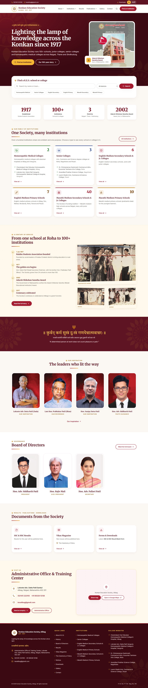

# K.E.S. Family Brand Guide — “Lamp & Lotus”

This website is the **parent design system** for every Konkan Education Society website. Each school or college site
should look like part of the same family: same colours, type, ornaments, header/footer behaviour — with its own name
and content. Everything below is implemented in this repository and reusable as-is.



## 1. Where the identity comes from

Everything is drawn from the Society’s emblem (`reference-assets/brand/kes-emblem.png`) and torch flag:

| Element | Meaning on the site |
| --- | --- |
| Ring of crimson lotus petals | `<PetalRing />`, the crimson `primary` scale |
| Golden samai with four flames, rising from a sun | `<Flame />`, the marigold `gold` scale |
| Leaf-green accents | `brand.accent` — success, “website live” badges |
| Sanskrit motto **॥ कुर्वन् कर्म सुखं दुःखं गणयेन्नात्मवान्नरः ॥** | Motto band, hero eyebrow |
| Torch flag, **प्रज्वालितो ज्ञानमयः प्रदीपः** | `flag` colour, About → Our Emblem & Flag |

Brand line: **“Lighting the lamp of knowledge across the Konkan since 1917.”**

## 2. Logo (emblem) usage

- The emblem artwork has a white background, so it is **always shown in a white disc** (`<Emblem />`), with a thin
  gold ring (`gold-300`) by default.
- **Clear space:** at least ¼ of the disc’s diameter on every side. Never place text inside the ring.
- **Minimum size:** 32 px on screen (favicon excepted). Header: 44–56 px. Footer lockup: 56 px.
- **On light backgrounds:** white disc + gold ring. **On dark (maroon) backgrounds:** the same disc — the white reads as
  a deliberate badge. Never recolour, crop, stretch, rotate or add shadows to the artwork itself.
- Generated assets (`npm run images`): `favicon.svg`, `favicon.ico` (16/32/48), `apple-touch-icon.png` (180 px, cream),
  `og-image.png` (1200×630, emblem + name on deep maroon).

## 3. Colour tokens (`tailwind.config.js`)

Shared with the Smt. J.R.H. Kanyashala site. Neutrals are warm: every `slate-*` class uses Tailwind’s `stone`.

| Token | Hex | Use | Contrast (WCAG) |
| --- | --- | --- | --- |
| `brand.primary` / `primary-700` | `#A51C30` | Buttons, links, accents | 7.5 : 1 on white · 7.1 : 1 on cream — AA/AAA text |
| `brand.secondary` / `primary-900` | `#5E1422` | Headings, motto band, admin sidebar | 13.1 : 1 on white |
| `primary-950` | `#3A0912` | Hero, footer | `primary-100` text 14.2 : 1 |
| `brand.gold` / `gold-400` | `#F5B534` | Marigold — **dark backgrounds only** | 9.4 : 1 on `primary-950`; **1.8 : 1 on white — never as text on light** |
| `brand.gold-dark` / `gold-700` | `#9C5B0D` | Eyebrows, gold text on light | 5.4 : 1 on white (AA) |
| `brand.accent` | `#2E7D32` | Leaf green — “Visit website”, success | 5.1 : 1 on white (AA) |
| `brand.light` | `#FBF8F4` | Page background | — |
| `brand.cream` | `#FFF8EC` | Alternate sections | — |
| `flag` *(new)* | `#E3123F` | Torch-flag pink — flame cores, one highlight per page | 4.75 : 1 on white (AA, use large) |

Institution-type accents — **small badges, icons and 4–6 px bars only, never section fills**:

| Type | Token | Hex | Text on light uses |
| --- | --- | --- | --- |
| Homoeopathic Medical | `cat.medical` | `#2E7D32` | same (5.1 : 1) |
| Senior Colleges | `cat.senior` | `#1E3A8A` | same (10.4 : 1) |
| Secondary & Jr. Colleges | `cat.secondary` | `#A51C30` | same (7.5 : 1) |
| Primary | `cat.primary` | `#C47A0B` | **`gold-800` `#7F4812`** (7.4 : 1) — `#C47A0B` is only 3.4 : 1 |

Also kept from the school site: `shadow-soft`, `shadow-card`, `bg-heritage-pattern` (faint crimson dot grid).

## 4. Typography

| Role | Font | Notes |
| --- | --- | --- |
| Headings | **Merriweather** 700/900 | `font-serif` |
| Body & UI | **Inter** 400–700 | `font-sans` |
| Sanskrit motto | **Tiro Devanagari Sanskrit** | `font-motto`, loaded as a subset of just the motto characters |
| Marathi UI | **Noto Sans Devanagari** 400/600 | `font-deva`; small subset on English pages, full font when Marathi is chosen |

Type scale (mobile → desktop): H1 hero 32 → 54 px · H1 inner pages 30 → 48 px · H2 30 → 36 px · H3 18–20 px ·
body 16–17 px · small 14 px · eyebrow 12 px uppercase, 0.18 em tracking, `gold-700`.

The **eyebrow** (`.eyebrow`) — tiny uppercase gold label with a flame — sits above every section title.
Section titles end with a 80 × 4 px crimson→gold rule.

## 5. The five signature elements (`src/brand/`)

1. **`<PetalRing />`** — 16-petal lotus ring in `currentColor`. Huge and faint (5–8 % opacity) behind heroes, small as
   ornaments, and as the loading spinner (`<LotusLoader />`). Rotation stops for visitors who prefer reduced motion.
2. **`<Flame />`** — four-flame samai glyph: list bullet, eyebrow prefix, timeline node.
3. **Archive treatment** (`<ArchivePhoto />`, `.archive-photo`) — old film scans shown as printed photos: sepia filter,
   maroon→gold multiply wash, cream border, small italic caption “From the K.E.S. archive”. Never full-bleed.
4. **Motto band** (`<MottoBand />`) — the Sanskrit motto large in Tiro Devanagari on `primary-900`, Marathi gloss and
   English meaning below.
5. **Family lockup** (`<FamilyLockup />`) — emblem + “Konkan Education Society, Alibag · Est. 1917” in the parent footer;
   “A Konkan Education Society institution” + link back on child sites.

## 6. Components

| Component | File | Purpose |
| --- | --- | --- |
| `PageHero` | `components/shared/PageHero.tsx` | Same banner as the school site + breadcrumbs + petal ornament |
| `SectionTitle` | `components/shared/SectionTitle.tsx` | Eyebrow + serif title + rule (+ optional action button) |
| `Picture`, `Emblem` | `brand/` | Responsive WebP/AVIF images from the manifest |
| Buttons | `index.css` | `.btn-primary`, `.btn-secondary`, `.btn-gold` (dark bg), `.btn-outline-light` (dark bg) — all ≥ 44 px tall |
| Cards & chips | `index.css` | `.card`, `.card-tint`, `.card-gold`, `.chip` + `.chip-active` / `.chip-idle` |
| Forms | `index.css` | `.form-label`, `.form-input` (44 px) |
| `Portrait` | `components/shared/Portrait.tsx` | 4:5 portrait frame, gold ring on hover |
| `InstitutionCard`, `CategoryBadge`, `CategoryIcon` | `components/shared/InstitutionBits.tsx` | Institution UI with type accents |
| `MagazineCover` | `components/shared/MagazineCover.tsx` | Generated cover (emblem + title + year) until a real one is uploaded |
| `MapEmbed`, `DocumentList`, `Reveal` | `components/shared/` | Lazy map, document list with friendly empty state, scroll fade-in |
| Header / drawer / footer | `components/layout/` | Utility bar, sticky shrinking header, Ctrl/⌘ + K search, full-screen mobile drawer |

Screenshots: [home (desktop)](docs/screenshots/home-desktop.jpg) · [home (tablet)](docs/screenshots/home-tablet.jpg) ·
[home (mobile)](docs/screenshots/home-mobile.jpg) · [institutions](docs/screenshots/institutions-desktop.jpg) ·
[board](docs/screenshots/board-desktop.jpg) · [history](docs/screenshots/history-desktop.jpg) ·
[admin](docs/screenshots/admin-documents.jpg)

Shared components contain **no Society-specific text** — names, mottos and contact details come from `src/data/` and
the admin settings, so child sites can import them unchanged.

## 7. Motion, accessibility and performance rules

- Motion is subtle: fade/slide-up once on scroll (`<Reveal />`), no auto-playing carousels. `prefers-reduced-motion`
  turns all animation off.
- WCAG 2.2 AA: headings in order, skip link, visible focus rings, ≥ 44 px tap targets, alt text on every image,
  contrast ≥ 4.5 : 1 for text (see table), full keyboard use of menus and dialogs.
- Mobile first: images via `<Picture>` with `srcset`, `loading="lazy"` except the hero (`fetchpriority="high"`);
  keep each page’s images under 600 KB.

## 8. The child-site footer lockup

```tsx
import FamilyLockup from './brand/FamilyLockup';

<FamilyLockup
  emblemSrc="/images/brand/kes-emblem"
  title="A Konkan Education Society institution"
  subtitle="Alibag · Est. 1917"
  href="https://<K.E.S. parent site URL>"
  linkLabel="Visit Konkan Education Society"
/>
```

Use `on="light"` on white backgrounds.

## 9. How to start a new institution website from this template

1. **Copy** this repository into a new folder (e.g. `KES_<SCHOOL>_WEBSITE`). Keep `src/brand/`, `src/components/`,
   `src/lib/`, `src/i18n/`, `src/admin/`, `server/`, `api/`, `scripts/`, `tailwind.config.js`, `src/index.css`, `vercel.json`.
2. **Assets:** put the institution’s logo and photos in `reference-assets/` (keep `brand/kes-emblem.png` for the
   family lockup) and run `npm run images`.
3. **Content:** replace `src/data/site.ts` (identity, history, leaders → principal/staff, settings) with the
   institution’s facts only. Delete `institutions.ts` / the finder pages if not needed, or keep the profile template.
4. **Header:** set the institution’s name and place; keep the utility bar, sticky shrink, Ctrl/⌘ + K search and drawer.
5. **Footer:** keep the maroon footer and add `<FamilyLockup title="A Konkan Education Society institution" … />`
   linking back to the parent site.
6. **Database:** use a new database name in `MONGODB_URI` (e.g. `kes_<school>`), set a new `JWT_SECRET` and admin password.
7. **Register it here:** in the parent site’s admin, open the institution and fill in its **Website** — the card,
   profile, footer (colleges) and JSON-LD `subOrganization` update automatically.
8. Run `npm run build` and `npm run lint`, check 375 / 768 / 1440 px, deploy to Vercel (see `README.md`).
