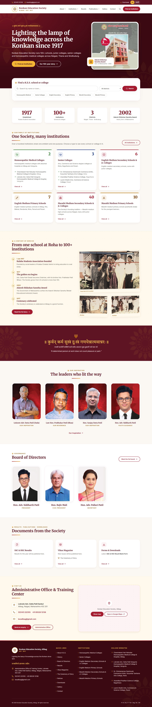

# Konkan Education Society (K.E.S.), Alibag — Organisation Website

The official website of Konkan Education Society, Alibag (est. 1917): the Society’s story, leadership and board, a
finder for every K.E.S. school and college, results and publications — plus a private admin dashboard.

It is also the **parent design system of the K.E.S. Family** (“Lamp & Lotus”). Every school and college site should be
built from it — see [`BRAND_GUIDE.md`](BRAND_GUIDE.md). Content still to collect is listed in [`CONTENT_TODO.md`](CONTENT_TODO.md).

- **Frontend:** React 19 + TypeScript + Vite + Tailwind CSS 3 + React Router 7 (framer-motion, lucide-react, clsx/tailwind-merge)
- **Backend:** Node.js + Express (`server/`), MongoDB via Mongoose, JWT + bcrypt admin login, multer uploads (Vercel Blob in production)
- **Same stack and patterns as** the Smt. J.R.H. Kanyashala site (`KESJRHSCHOOL_WEBSITE`).



## Running it

Needs **Node.js 22.18 or newer** (the seed reads the TypeScript data files directly) and **MongoDB**.

1. Make sure the **MongoDB** service is running (default `mongodb://127.0.0.1:27017`).
2. Copy `.env.example` to `.env` and set `JWT_SECRET` and `ADMIN_PASSWORD` (a `.env` with random values already exists on this computer).
3. Install and start:

```bash
npm install
```

```bash
npm run dev
```

This starts the API (port 5050) and the website (http://localhost:5173). The first start fills the database with the
starting content from `src/data/` and creates the admin account from `.env`.

`src/data/*.ts` is the single source of truth. `scripts/export-data.mjs` copies it to `server/seed-data.json` before
every `build`, `server` and `seed` command, so the API itself never has to run TypeScript (locally or on Vercel).
`MONGODB_URI` should include a database name, e.g. `mongodb+srv://…mongodb.net/kes_alibag?retryWrites=true&w=majority`
(without one, MongoDB uses a database called `test`).

| Command | What it does |
| --- | --- |
| `npm run dev` | Website + API together for development |
| `npm run build` | Exports `server/seed-data.json`, writes `sitemap.xml`/`robots.txt`, type-checks, builds into `dist/` |
| `npm start` | Runs the API and serves the built website on http://localhost:5050 |
| `npm run seed` | Adds starting content to empty collections |
| `npm run seed:reset` | **Deletes all website content** and reloads the starting content |
| `npm run images` | Regenerates optimised images, favicons and the share image from `reference-assets/` |
| `npm run lint` | oxlint |

## Images

Originals live in `reference-assets/` and are never edited. `npm run images` (sharp) writes:

- `public/images/<folder>/<name>-<width>.webp` — 480/960/1600 px (archive photos, building), 400/800 px (portraits),
  96/192 px (emblem); widths larger than the original are skipped. The building also gets `.avif`.
- `src/data/imageManifest.json` — read by `<Picture>` to build `srcset`, `width` and `height`.
- `public/favicon.svg`, `favicon.ico`, `apple-touch-icon.png`, `og-image.png` (1200×630).
- `public/documents/` — the real SSC & HSC result blank form.

In content, generated images are referenced by their base path (e.g. `/images/board/rajiv-mali-vice-president`);
uploaded files use their full URL.

## Deploying to Vercel

Full step-by-step guide: **[`DEPLOY_VERCEL.md`](DEPLOY_VERCEL.md)** (Atlas network access, importing the repo,
environment variables, Blob storage for uploads, checks and troubleshooting).

In short: `api/index.js` wraps the Express app as one serverless function; `vercel.json` routes `/api/*` and
`/uploads/*` to it and sets the security headers. Set `MONGODB_URI`, `JWT_SECRET`, `ADMIN_USERNAME`,
`ADMIN_PASSWORD` and `SITE_URL`, and connect a Vercel Blob store for uploads (4 MB per file).

## Admin dashboard

Open **`/admin`** (not linked from the public site; `robots.txt` disallows it). Log in with `ADMIN_USERNAME` /
`ADMIN_PASSWORD` from `.env`; change the password in Settings. Logins expire after 12 hours; 10 wrong attempts lock an
address for 15 minutes.

| Section | Shown on |
| --- | --- |
| Institutions (name, town, type, medium, Jr. College, website, principal, contacts, logo) | Finder, category pages, profiles, footer |
| Results & Publications (SSC/HSC results, Ceremony of Glory, Vikas Magazine, forms — empty slots per year) | Results, Competition, Vikas Magazine, Downloads, Home |
| Notices (with attachments, pinning) | Notices |
| Board of Directors | Board page, Home |
| Our Inspiration | Leadership page, Home |
| History Timeline | History page, Home (highlights) |
| Gallery (albums, archive treatment) | Gallery |
| Settings (contact details, announcement bar, hidden extra numbers, social links, password) | Whole site |
| Enquiries (contact-form inbox) | — |

Uploads: PDF, JPG, PNG and WebP only, checked by type **and** by file contents; saved in `server/uploads/` locally and
in Vercel Blob in production.

## Security notes

The old `kesalibag.edu.in` server was compromised; nothing is copied or linked from it. This build adds: helmet + strict
CSP, rate limits on login and the enquiry form (plus a honeypot field), schema validation with length limits on every
route, only `http(s)://` or site-relative links accepted in content, no secrets or environment variables in the browser
bundle, `nosniff` on uploaded files.

## Project structure

```
server/            Express API — index.js (routes), models.js (collections), seed.js, seed-data.json (generated)
api/index.js       Vercel serverless entry
scripts/           images.mjs (sharp pipeline), sitemap.mjs, export-data.mjs (src/data → server/seed-data.json)
src/
  brand/           K.E.S. Family design system: PetalRing, Flame, Emblem, FamilyLockup, MottoBand, ArchivePhoto, Picture
  components/      layout (header, drawer, footer) and shared UI (PageHero, SectionTitle, cards, search…)
  data/            single source of truth: site.ts, institutions.ts, categories.ts, pages.ts, types.ts
  i18n/            t() helper, en.ts, mr.ts
  pages/           public pages
  admin/           admin dashboard (loaded only at /admin)
  lib/             API client, content hooks, search, page meta
docs/screenshots/  Home (desktop, tablet, mobile), Institutions, Board, History, Admin
```

## Verification done

- `npm run build` and `npm run lint` pass with no errors or warnings.
- Every route renders at 375 / 768 / 1440 px with no horizontal scroll, no broken images, alt text on every image, and no
  console errors under the production CSP.
- Lighthouse (mobile): **Accessibility 100, Best Practices 100, SEO 100**. On the build computer, Lighthouse could not
  record a performance trace (`NO_NAVSTART`, in both Chrome and Edge), so performance was measured with DevTools
  throttling instead (slow 4G, 4× CPU): first paint ≈ 2.4–3.0 s, layout shift ≈ 0.01, about 450 KB transferred and
  ≈ 50 KB of images on the home page. Re-run Lighthouse against the Vercel deployment to confirm the ≥ 90 performance target.
